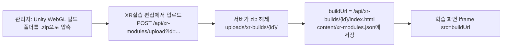

# XR실습(HnaCare XR) 구성 지침

> 로그인 후 대메뉴(진도관리, `/courses`)에서 **XR실습**을 선택했을 때 실행되는
> 화면·데이터·업로드 구조를 정의한다. `docs/PROGRAM_DESIGN.md`(전체 서비스 설계)와
> `content/README.md`(콘텐츠 파일 규칙)를 함께 참고할 것.
>
> 이전 버전의 이 문서는 PDF 스펙을 그대로 옮긴 "5대 모듈 + 인터랙션 버튼 + 목데이터
> 결과문구" 프로토타입(Three.js 와이어프레임/`public/xr/vital-signs.html` 심화
> 데모)을 설명했다. 그 프로토타입은 실제 3D 콘텐츠가 아니었으므로 전부 걷어내고,
> **관리자가 Unity로 직접 제작한 WebGL 빌드를 업로드해 그대로 실행**하는 방식으로
> 교체했다. 아래는 그 구조만 설명한다.

---

## 1. 개요

- XR실습 모듈은 관리자가 **Unity(WebGL 플랫폼)로 만든 3D 인터랙션 콘텐츠**를
  `.zip`으로 올리면, 서버가 압축을 풀어 정적 파일로 호스팅하고 학습 화면은 그
  결과물을 `<iframe>`으로 띄운다. 콘텐츠의 실제 로직(청진기 소리, 혈압계 게이지,
  무균술 판정 등)은 전부 Unity 프로젝트 쪽에서 구현한다 — 이 앱은 업로드·배치·
  표시만 담당한다.
- Unreal Engine의 웹 임베드(Pixel Streaming)는 별도 GPU 스트리밍 서버가 필요해
  이 프로젝트 범위 밖이고, APK는 브라우저에서 실행할 수 없어 지원하지 않는다.
  **Unity WebGL 빌드만 지원**한다.
- 모듈을 몇 개 둘지, 어떤 모듈에 어떤 빌드를 연결할지는 전부 관리자가 "XR실습
  편집" 화면에서 정한다 — 더 이상 코드에 고정된 5대 모듈이 없다. 빌드를 올리기
  전까지 해당 모듈은 "콘텐츠 없음" 상태로 비어 있다.

---

## 2. 앱 통합 지점 (로그인 → 대메뉴 → XR실습)

```mermaid
graph LR
    A[로그인 /login] --> B[진도관리 대메뉴 /courses]
    B -->|기초한글| C[/learn/...]
    B -->|실습한글| C
    B -->|XR실습| D[XR 모듈 목록 /xr]
    D -->|모듈 선택| E[XR 실습 화면 /xr/:moduleId]
    E -->|iframe| F[Unity WebGL 빌드]
```

- `/courses`의 "XR실습" 섹션은 `lib/courses.ts`에서 `content/xr-modules.json`을
  읽어 모듈명·법정 실습시간을 보여주고, 각 항목이 `/xr/${module.id}`로 연결된다.
- `/xr`(모듈 목록)과 `/xr/[moduleId]`(실습 화면)는 다른 라우트와 동일하게
  `AuthGuard role="any"`로 로그인만 확인한다.
- 관리자 전용 `/admin/xr-editor`는 `public/hancare-xr-editor.html`을 iframe으로
  띄운다(다른 콘텐츠 편집기와 동일한 패턴).

---

## 3. 업로드 → 호스팅 → 실행 흐름



- **업로드 API**: `POST /api/xr-modules/upload?id={moduleId}` — 본문은 zip
  바이트 그대로(스트리밍 수신, 최대 400MB). `lib/xrBuilds.ts`의
  `extractXrBuild()`가 처리한다.
  - **경로 탈출(zip-slip) 방지**: 각 항목의 정규화된 상대경로가 `..`로
    시작하거나 절대경로면 전체 업로드를 거부한다(디스크에 아무것도 쓰기 전에
    전부 검사).
  - **zip 폭탄 방지**: 압축 해제 후 합계 용량(기본 800MB)과 항목 수(기본
    8000개) 상한을 넘으면 거부한다.
  - **공통 루트 폴더 자동 제거**: 관리자가 Unity 빌드 출력 폴더 전체를 통째로
    압축했다면(그 폴더 하나가 모든 항목의 공통 조상이면) 그 폴더명을 벗겨
    `index.html`이 바로 밑에 오도록 맞춘다.
  - `index.html`을 찾지 못하면(루트 또는 그 바로 아래 한 단계) 오류로 거부한다.
  - 성공하면 기존 빌드를 통째로 지우고 새로 쓴 뒤 `{ buildUrl, fileCount }`를
    돌려준다.
- **저장 위치**: `uploads/xr-builds/{moduleId}/` — `public/`이 아니다. 영상
  업로드(`uploads/videos/`, §5 VIDEO_EDITOR_DESIGN)와 같은 이유로, 운영 서버는
  빌드 시점에 있던 `public/` 파일만 제공하므로 런타임에 올린 파일은 `uploads/`에
  두고 전용 라우트로 제공해야 한다. 이 디렉터리는 git에 포함되지 않는다
  (`.gitignore`).
- **제공 라우트**: `GET /api/xr-builds/[moduleId]/[...path]` —
  `lib/xrBuilds.ts`의 `resolveXrBuildFile()`로 경로 탈출을 막고,
  `xrBuildFileHeaders()`로 확장자별 Content-Type을 정한다. Unity WebGL이
  Gzip/Brotli로 압축해 올리는 경우(`.data.gz`, `.wasm.br` 등)도 `Content-Encoding`
  헤더를 붙여 그대로 서빙한다 — 단, 가능하면 Unity 빌드 설정의 Compression
  Format을 **Disabled**로 두길 권장한다(가장 호환성이 좋고 빠르다).
  이 라우트도 다른 `/api/*`와 동일하게 로그인한 사용자만 접근할 수 있다
  (`middleware.ts`).
- 모듈이 삭제되거나(편집기에서 모듈 행 삭제 후 저장) 다른 모듈로 교체되면
  `deleteXrBuild()`가 `uploads/xr-builds/{id}/`를 통째로 지운다(`PUT
  /api/xr-modules`가 이전 모듈 id 목록과 비교해 자동 처리).
- **외부에 이미 호스팅된 빌드**를 쓰고 싶으면 업로드 없이 `buildUrl`에 그 주소를
  직접 입력해도 된다(S3, 별도 CDN 등). 단일 파일판(`hangulcare.html`)에는
  업로드 서버가 없으므로 이 방식만 쓸 수 있다 — §6 참고.

---

## 4. 화면 UI 구성

```
┌─────────────────────────────────────────────────────────────┐
│ 모듈명 · 영문명              모듈 2 / 5   ←  →   ← 목록       │ XrModuleHeader
├─────────────────────────────────────────────────────────────┤
│                                                               │
│              <iframe src={buildUrl}>  (16:9)                 │ Unity WebGL 빌드
│                                                      [전체화면]│
│                                                               │
├─────────────────────────────────────────────────────────────┤
│ 법정 실습시간 20시간                                           │
└─────────────────────────────────────────────────────────────┘
```

`buildUrl`이 비어 있으면(아직 빌드를 올리지 않은 모듈) iframe 대신 "아직 이
모듈에 콘텐츠가 연결되지 않았습니다" 안내 카드를 보여준다.

| 컴포넌트 | 역할 |
|---|---|
| `components/XrModuleGrid.tsx` | `/xr` 목록 — 모듈 카드(순서·법정시간·콘텐츠 연결 여부) |
| `components/XrPracticeScreen.tsx` | `/xr/[moduleId]` — iframe + 전체화면 토글 + 이전/다음/목록 이동 |
| `public/hancare-xr-editor.html` | 관리자 편집기 — 모듈 CRUD + zip 업로드 위젯(§6) |
| `lib/xrBuilds.ts` | 서버 전용 — zip 추출·검증, 빌드 파일 경로 안전성 검사 |

Unity WebGL 콘텐츠 내부의 완료 신호(예: "이 환자 확인 끝났음")를 앱이 알아내는
방법은 없다 — iframe은 기본적으로 불투명한 블랙박스다. 완료율·리포트 제출 같은
진행 상태 추적 기능은 Unity 콘텐츠가 `window.postMessage`로 알려주는 자체
프로토콜을 만들기 전까지는 제공하지 않는다(가짜 완료 표시를 보여주는 대신,
기능 자체를 없앴다 — 이전 버전은 `lib/xrStore.ts`로 목데이터 완료 상태를
추적했으나 실제 콘텐츠 진행과 무관했다).

---

## 5. 관리자 편집기 (`public/hancare-xr-editor.html`)

다른 콘텐츠 편집기(단어장·영상·역할극)와 동일한 3중 백엔드 어댑터 패턴을 쓴다.

| 실행 환경 | 백엔드 | 업로드 위젯 |
|---|---|---|
| Next.js 서버에서 열림(`/admin/xr-editor`) | `GET/PUT /api/xr-modules` | 보임 — `POST /api/xr-modules/upload`로 직접 업로드 |
| 단일 파일판(`hangulcare.html`) 안에서 iframe(`?host=hangulcare`) | `postMessage`(`hcXr` 메시지, 이 브라우저의 localStorage에 보관) | 숨김 — `buildUrl`을 텍스트로 직접 입력(서버가 없어 업로드 불가) |
| `file://`로 단독 실행 | 없음(JSON/엑셀 내보내기로만 보관) | 숨김 — 동일하게 텍스트 입력만 |

필드: 모듈 ID(영문 소문자·숫자·하이픈 — 업로드 폴더명으로도 쓰임)·순서·
모듈명(한/영)·법정 실습시간·빌드 URL. 엑셀 내보내기는 `Modules` 시트 하나
(id/order/titleKo/titleEn/legalHours/buildUrl)만 쓴다.

---

## 6. 데이터 스키마

```ts
interface XrModule {
  id: string;             // uploads/xr-builds/{id}/ 폴더명으로도 쓰여 영문 소문자·숫자·하이픈만 허용
  order: number;
  titleKo: string; titleEn: string;
  legalHours: number;                 // 법정 실습시간
  buildUrl?: string;                  // Unity WebGL 빌드 index.html URL. 없으면 "콘텐츠 없음"
  buildUploadedAt?: number;           // 직접 업로드한 경우의 업로드 시각(epoch ms, 표시용)
}
```

- 위치: `content/xr-modules.json` (기본값은 빈 배열 `[]` — 관리자가 모듈을
  추가하고 빌드를 올려야 채워진다)
- 로딩: `lib/content.ts`의 `getXrModules()`/`getXrModule(id)` — 다른 콘텐츠와
  동일하게 매 요청마다 파일을 새로 읽는다(`content/README.md` 참고)
- 검증: `lib/contentStore.ts`의 `cleanXrModules()` — id 중복·형식, `legalHours`
  숫자 범위를 확인한다. `SAFE_MODULE_ID` 정규식은 `lib/xrBuilds.ts`의
  `isSafeModuleId()`와 같은 규칙을 쓴다(의도적으로 중복 정의 — 폴더명 안전성과
  콘텐츠 검증이 같은 규칙을 따라야 하기 때문).
- 진도관리 메뉴 연동: `lib/courses.ts`의 `getCourseSections()`가 이 목록을 읽어
  XR실습 섹션 아이템(모듈명 + 법정시간)을 자동 생성한다(변경 없음).

---

## 7. 알려진 제약 / 다음 단계

- **완료 추적 없음**: §4에서 설명한 대로, Unity 콘텐츠의 내부 진행 상태를 앱이
  알 방법이 없다. 필요하면 Unity 쪽에 `window.parent.postMessage(...)`로 완료
  이벤트를 보내는 작은 브리지 스크립트를 만들고, `XrPracticeScreen.tsx`에
  `message` 리스너를 추가하는 방식으로 확장할 수 있다(Unity 프로젝트 코드 수정
  필요 — 이 세션 범위 밖).
- **Unreal / APK 미지원**: §1에서 설명한 대로 의도적으로 범위에서 제외했다.
  Unreal 콘텐츠를 웹에 올리려면 Pixel Streaming용 GPU 스트리밍 서버가 별도로
  필요하다.
- **압축 포맷 호환성**: Unity가 Brotli로 압축한 빌드(`.br`)는 일부 구형
  브라우저에서 `Content-Encoding: br` 지원이 제한적일 수 있다. 가능하면
  Compression Format을 Disabled로 빌드하길 권장(§3).
- **대용량 빌드**: 업로드 상한은 400MB(zip), 해제 후 800MB다. 더 큰 빌드가
  필요하면 `lib/xrBuilds.ts`의 `MAX_XR_BUILD_UPLOAD_BYTES`를 조정하거나, 외부
  CDN에 올리고 `buildUrl`만 입력하는 방식(§3)을 쓴다.

---

## 8. 다국어 / LMS 연동 메모

- **다국어**: 모듈명(`titleKo`/`titleEn`)만 앱이 관리한다. Unity WebGL 콘텐츠
  내부의 언어 전환은 Unity 프로젝트 쪽 책임이다(필요하면 Unity가 URL 쿼리스트링
  등으로 언어를 받도록 구현해, `buildUrl`에 포함시키는 방식을 쓸 수 있다).
- **LMS 연동**: `data/learners.json` + `/admin` 화면이 현재는 목데이터이지만,
  실제 LMS 연동 시 `docs/PROGRAM_DESIGN.md` §4 User/Session Service의 API로
  대체한다. XR실습의 완료/점수 데이터를 LMS로 보내려면 §7에서 설명한 Unity
  postMessage 브리지가 먼저 필요하다.
- **진도관리**: `/admin`의 "코스 구성" 카드가 등록된 XR 모듈 개수를 그대로
  보여준다(코드 변경 불필요) — 다만 모듈이 있어도 `buildUrl`이 비어 있으면
  학습자 화면에는 "콘텐츠 없음"으로 보인다는 점에 유의.
